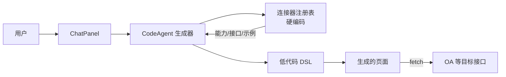

# 连接器 MVP 设计文档

## 背景与目标

在 @mybricks/plugin-ai 的低代码生成链路中，用户生成的页面需要复用企业既有系统（如 OA、ERP）的数据接口，而不是每次都由 AI 重新生成新接口。

本 MVP 目标：在**前端**实现一个最小可用的连接器能力，让 AI 生成页面时能够引用预置的连接器接口，并在生成的页面产物中通过 `fetch` 直接调用。

## 范围界定

- **仅前端实现**：不引入后端网关、不引入鉴权服务、不引入运行时适配器。
- **数据写死**：连接器定义、接口元数据、示例数据全部硬编码在前端源码中。
- **直接 fetch**：生成的产物代码中直接使用 `fetch(url, options)` 调用目标接口。
- **单一场景验证**：优先支持 OA 类「查询待办列表」这类只读接口。

非目标（后续迭代）：
- 连接器注册/发现服务
- 统一网关 / Connector Runtime
- 动态鉴权 / OAuth 流程
- 写操作接口的统一事务或审计

## 总体架构



## 核心组件

### 1. 连接器注册表（Connector Registry）

位置：`packages/plugin-lowcode/src/connectors/registry.ts`

- 以常量对象形式硬编码连接器列表。
- 每个连接器包含：
  - `id`：唯一标识，如 `oa-connector`
  - `name`：展示名，如 `OA 办公平台`
  - `description`：自然语言描述，用于 AI 判断
  - `baseUrl`：目标系统前缀，如 `https://oa.example.com/api`
  - `interfaces`：接口列表

```ts
interface ConnectorInterface {
  id: string;
  name: string;
  description: string;
  path: string;
  method: 'GET' | 'POST';
  parameters: Array<{
    name: string;
    type: string;
    description: string;
    required: boolean;
  }>;
  responseExample: unknown;
}

interface Connector {
  id: string;
  name: string;
  description: string;
  baseUrl: string;
  interfaces: ConnectorInterface[];
}
```

### 2. 生成器提示注入

位置：`packages/plugin-lowcode/src/connectors/prompt.ts`

- 将 Registry 中的连接器信息序列化为文本，追加到 Agent system prompt 或每次请求的上下文中。
- 明确告诉模型：
  - 可用的连接器有哪些
  - 每个接口能做什么
  - 当用户需求可被连接器覆盖时，必须复用连接器接口
  - 复用时需要在 DSL 中生成对应的数据源调用

### 3. 生成产物中的调用方式

生成器在 DSL 或页面代码中生成如下形态的数据源调用：

```ts
// 低代码 DSL 中的数据源示例
{
  "type": "connector",
  "connectorId": "oa-connector",
  "interfaceId": "todo-list",
  "params": {
    "pageSize": 10
  },
  // 运行时直接展开为 fetch 调用
  "executor": "fetch(`${baseUrl}/todo/list?pageSize=${params.pageSize}`)"
}
```

为简化 MVP，可直接在生成的组件代码中内联 `fetch`：

```ts
useEffect(() => {
  fetch('https://oa.example.com/api/todo/list?pageSize=10')
    .then(r => r.json())
    .then(setList);
}, []);
```

> 实际落地时，优先复用项目已有的低代码「数据源/服务接口」机制；如不存在，则先生成内联 fetch，后续再抽象为 DSL 节点。

### 4. 运行时注入（可选兜底）

位置：`packages/plugin-lowcode/src/connectors/runtime.ts`

- 提供一个最小化的 `ConnectorRuntime` 对象，暴露 `call(connectorId, interfaceId, params)` 方法。
- MVP 内部直接拼 URL 并 `fetch`。
- 便于后续从直接调用平滑迁移到统一网关，生成产物不需要改动。

```ts
export const connectorRuntime = {
  async call(connectorId: string, interfaceId: string, params?: Record<string, unknown>) {
    const connector = registry.find(c => c.id === connectorId);
    const iface = connector?.interfaces.find(i => i.id === interfaceId);
    if (!connector || !iface) throw new Error(`Unknown connector ${connectorId}.${interfaceId}`);

    const url = new URL(iface.path, connector.baseUrl);
    if (iface.method === 'GET' && params) {
      Object.entries(params).forEach(([k, v]) => url.searchParams.append(k, String(v)));
    }

    const res = await fetch(url.toString(), {
      method: iface.method,
      headers: { 'Content-Type': 'application/json' },
      body: iface.method === 'POST' ? JSON.stringify(params) : undefined,
    });
    return res.json();
  },
};
```

### 4. 生成产物中的使用示例

生成的页面代码或 DSL 配置中，使用 `connectorRuntime.call` 发起调用：

```ts
import { connectorRuntime } from "@mybricks/plugin-ai/connectors";

const data = await connectorRuntime.call("oa-connector", "todo-list", { pageSize: 10 });
```

在 MVP 阶段，如果生成的产物无法直接导入该模块，可以在页面 JS 代码中使用等价实现：

```ts
const data = await fetch("https://oa.example.com/api/todo/list?pageSize=10").then(r => r.json());
```

`connectorRuntime` 的作用是统一调用入口，后续迁移到网关时只需替换该实现，生成产物无需改动。

## 数据流

1. 用户在 ChatPanel 输入需求：「帮我做一个请假审批看板」。
2. CodeAgent 收到需求后，读取 Connector Registry 中的 OA 连接器信息。
3. Agent 判断「请假审批」相关数据可由 OA 连接器中的 `leave-approval-list` 接口覆盖。
4. Agent 生成低代码页面 DSL，其中包含对 `oa-connector.leave-approval-list` 的调用描述。
5. 页面渲染时，执行生成的 `fetch` 调用，从 OA 系统获取数据并展示。

## 文件结构

```
packages/plugin-lowcode/src/connectors/
├── index.ts          # 统一导出
├── registry.ts       # 硬编码连接器定义
├── prompt.ts         # 将 Registry 转为 Agent prompt 片段
└── runtime.ts        # 前端运行时最小调用封装
```

## 接入生成器

在 `packages/plugin-lowcode/src/tools.ts` 或生成器入口中，将连接器注册表信息注入 Agent 上下文：

```ts
import { buildConnectorPrompt } from '../connectors/prompt';

const systemPrompt = `${baseSystemPrompt}\n\n${buildConnectorPrompt()}`;
```

## 风险与注意点

1. **CORS 问题**：前端直接 `fetch` OA 真实接口，目标系统必须允许跨域；否则页面无法运行。MVP 阶段建议用浏览器代理或测试环境接口验证。
2. **鉴权缺失**：MVP 不处理 Token/OAuth，假设接口公开或已由网关统一鉴权。
3. **写操作风险**：MVP 优先只读接口，避免误生成写操作导致数据问题。
4. **URL 硬编码**：`baseUrl` 写死在源码中，不同环境需要重新构建或后续改为配置化。
5. **AI 误判**：需要给 Agent 明确的规则，避免「明明连接器可用，AI 仍然自己生成接口」。

## 后续演进方向

- 将 Registry 从硬编码改为从服务端获取。
- 引入 Connector Runtime 网关层，将前端直接 fetch 改为调用统一网关。
- 增加接口返回字段与 UI 组件字段的自动映射。
- 支持连接器的版本管理和环境隔离。
