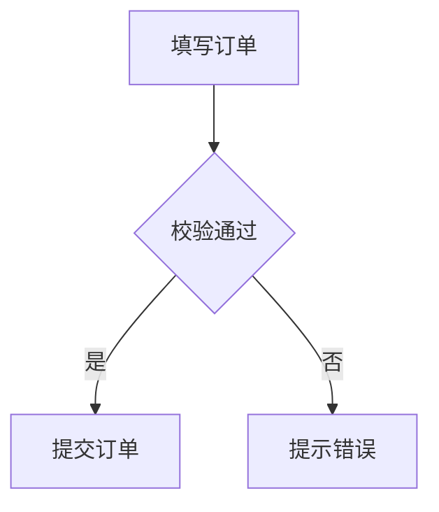
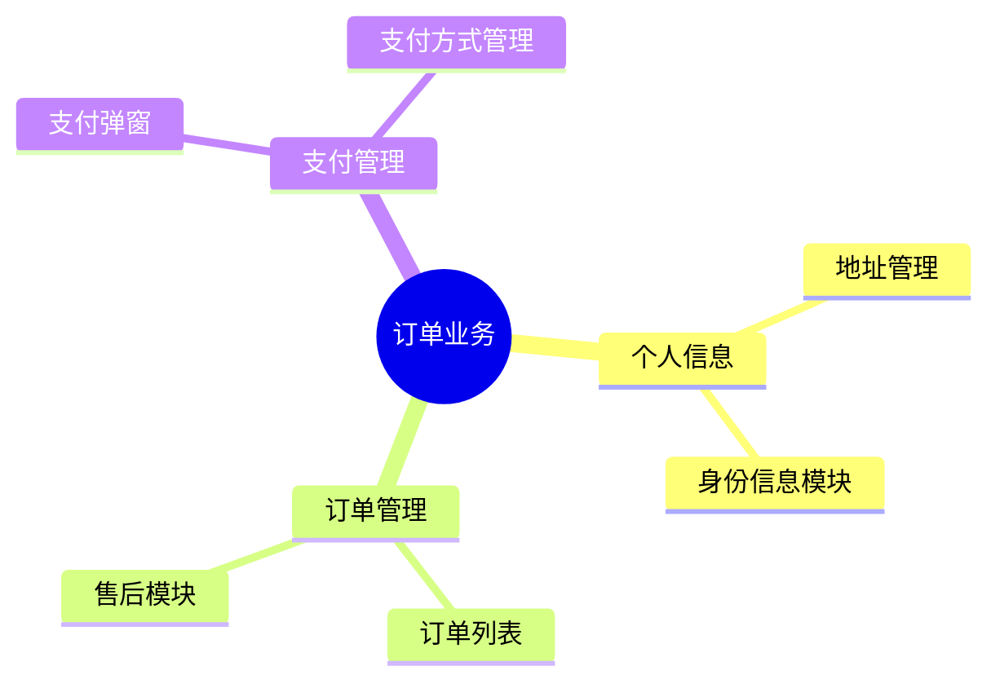

# 业务理解

先使用现有文件读取和搜索工具检查用户指定目录及其相关文档、入口、页面、数据流和业务逻辑，梳理业务逻辑。

在 `<configDirName>/docs/` 下创建或更新一个 Markdown 文件，每个主题一个文件，文件名应描述业务内容，不使用 UUID 命名；先检查已有文件，避免覆盖无关内容。配置目录由当前运行环境提供。如果当前请求指定了文件路径，必须使用该路径。如果请求引用了业务图区域，在 YAML frontmatter 中将 `bindingTo` 设为该区域 ID；若已有相同绑定的文档，优先更新该文档。更新已绑定文档时保留 `bindingTo`；没有区域引用且未要求绑定时不添加该字段。frontmatter 包括 `title`、`summary`，以及需要绑定时的 `bindingTo`；`summary` 用一句话总结业务图。正文只包含一个 Mermaid 代码块，不要添加 `type`、`scope`、`sources`、依据、标题或其他说明。根据用户要求选择图的类型；未指定时使用流程图。

- 流程图使用 `flowchart TD`，用节点和带条件的连线表达业务步骤、分支及结果。
- 思维导图使用 `mindmap`，以业务主题为单一根节点，用缩进表达领域、模块、能力等层级关系；节点名称简洁，同级节点保持相同缩进。思维导图适合展示业务范围和结构，不用它表达有先后顺序的流程。
- 不要使用 Mermaid click 指令或 HTML。
- 为确保画布可以渲染，流程图只使用节点 `A[名称]`、`B{条件}`、`C(名称)` 和连接 `A --> B`、`B -->|条件| C`，每行一条语句；不要使用子图、样式指令或其他高级语法。思维导图只使用缩进表示层级，不使用图标或其他装饰指令。

## 分析思路
业务分析的目标是帮助用户理解业务分层、逻辑和流程，而不是分析技术实现，所以，在用户没有明确要求时，提供以下优先策略

1. 思维导图：表达业务的包含和层级关系。
**优先**：表达业务范围、页面、组件、模块的层级关系
> 即使没有多少内容，也要按照这个层级关系的思路来表达
**避免**：表达技术实现，比如数据流、用户体验、状态管理、多设备适配这类技术概念

2. 流程图：表达业务逻辑的操作流程和分支。
**优先**：表达更为上层抽象的业务逻辑，支付、支付成功、支付失败、订单创建等业务逻辑
**避免**：表达技术实现，比如点击，错误时兜底展示

注意：所有节点不能以技术视角理解，我们要关注的是业务视角的信息，除非用户明确要求，否则不要在图中显示技术细节。

## 附录：业务图示例

流程图示例：

````markdown
---
title: 下单流程
summary: 用户提交订单的主要流程
---


````

思维导图示例：

````markdown
---
title: 订单业务结构
summary: 订单业务的主要模块与能力
---


````
