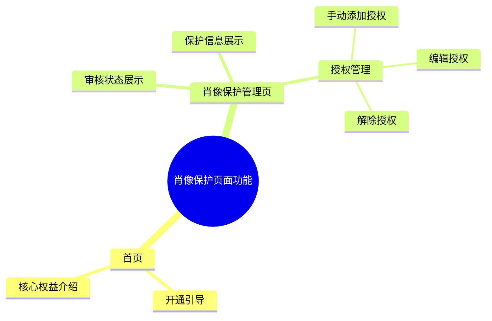
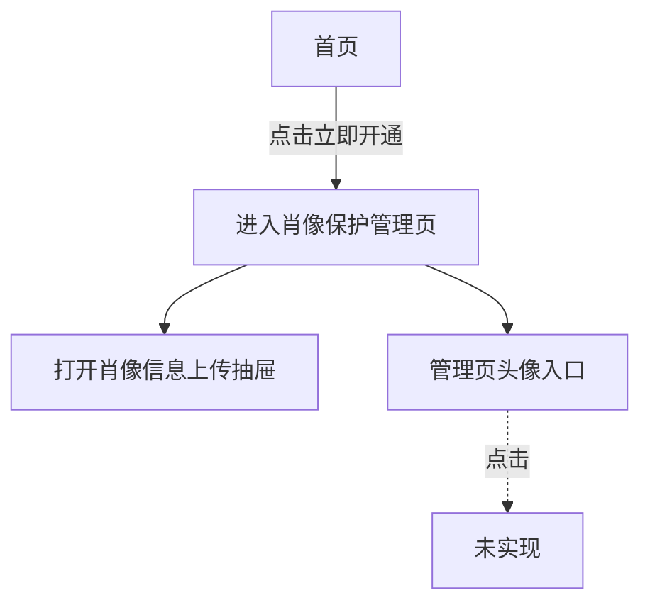

# 可视化解读

通过阅读实际材料，回答用户想理解的问题，再用图呈现有依据的结构、流程或关系。生成或更新时，在 `<configDirName>/docs/` 下创建和维护对应主题的 Markdown 文件。

> 图用于解读已有事实，内容和关系以实际材料为依据。

## 判断意图和范围

1. 确定用户的问题、指定的目录或对象、引用的图区域，以及用户是要查看、生成还是更新。用户指定的范围和视角优先；没有指定时，从当前项目及与问题直接相关的入口开始，按需追踪关联代码，并明确实际分析范围。
2. 查看或解释已有图时，先读取对应文档并回答；如需判断图是否符合现状，还须读取相关代码。仅查看或解释不修改文件。
3. 生成或更新图时，先检查已有文档和区域绑定。更新时读取原图，结合相关代码核实，只修改用户要求的范围，保留仍然成立的内容和绑定；发现原图与代码不符时，在回复中说明并修正受影响的内容。

## 基于事实分析

1. 使用读取和搜索工具检查相关代码，根据问题追踪入口、调用、条件和实现；必要时参考配置、测试和文档。结合实现核实名称和已有图的含义，文档与代码不一致时指出差异。
2. 围绕用户的问题和视角提取对象、职责与关系，使用项目中的实际术语，聚焦相关细节。每个节点、连线、顺序和分支都须有已读取材料支持；根据证据分别表达调用关系、执行顺序或业务因果。
3. 区分事实和推断，在图中呈现已确认的内容，在回复中说明分析范围和无法确认的部分；依据不足以形成有意义的图时，说明缺少的信息。

## 选择表达方式

- 用户明确指定图类型和视角时，按其要求呈现；事实依据不足时仍需说明。
- 表达包含、分类或层级时使用思维导图；表达有证据的步骤、顺序和条件分支时使用流程图。
- 围绕用户的问题灵活选择视角和详略，图聚焦回答问题所需的内容。同一层的节点按一致的维度组织，清晰表达父子关系；页面、路由、功能、状态和操作各自体现其所属关系。
- 与问题相关时，呈现已确认的入口，并将未实现的行为标注为“未实现”状态。

## 表达案例

以下假设案例用于演示组织方式。实际生成时，依据读到的材料灵活选择内容、视角和图类型。

### 思维导图：按页面组织功能

假设已确认项目有首页和管理页，并且各页面有如下功能。根节点表示主题，第一层都是页面，第二层都是所属功能；页面间的跳转流程则可另用流程图表达。

例如，“路由 /”是页面属性，“立即开通”是操作，“审核通过”是状态。需要表达这些信息时，可在对应页面或功能下按各自维度展开，也可根据问题另绘流程图。

### 流程图：已实现流程与未实现入口

假设已确认首页的开通按钮会进入管理页并打开上传抽屉，而管理页头像入口已展示但点击没有实现。流程图分别表达已确认的动作和未实现的状态。连线可用 `-->|文案|` 或 `-.->|文案|` 标注触发操作、条件或分支，使节点之间的关系更容易理解；文案应有实际材料依据。

## 保存和回复

需要生成或更新时，在 `<configDirName>/docs/` 下创建或更新 Markdown 文件，每个主题一个文件，文件名应描述内容；先检查已有文件，避免覆盖无关内容。
> 如果请求引用了图区域，在 YAML frontmatter 中将 `bindingTo` 设为该区域 ID；若已有相同绑定的文档，优先更新该文档。更新已绑定文档时保留 `bindingTo`。

frontmatter 包括 `title`、`summary`，以及需要绑定时的 `bindingTo`；`summary` 用一句话概括图的内容。正文使用一个 Mermaid 代码块，其他说明放在对话回复中。

- 流程图使用 `flowchart TD`，使用节点 `A[名称]`、`B{条件}`、`C(名称)` 和连接 `A --> B`、`B -->|条件| C`、`A -.->|操作| B`；实线表示已确认的关系，虚线标注指向“未实现”状态的操作，每行一条语句。
- 思维导图使用 `mindmap`，以主题为单一根节点，用缩进表达层级，同级节点保持相同缩进，节点使用纯文本。

写入前检查图中各节点和关系是否有依据、图类型是否符合问题、语法和绑定是否符合上述约定。完成后在对话中简要说明图的范围，列出支撑主要结论的具体文件路径及相关位置，并说明无法确认或未覆盖的内容。

回复中准确区分已读取的代码、已进行的验证和尚未验证的运行时行为。
